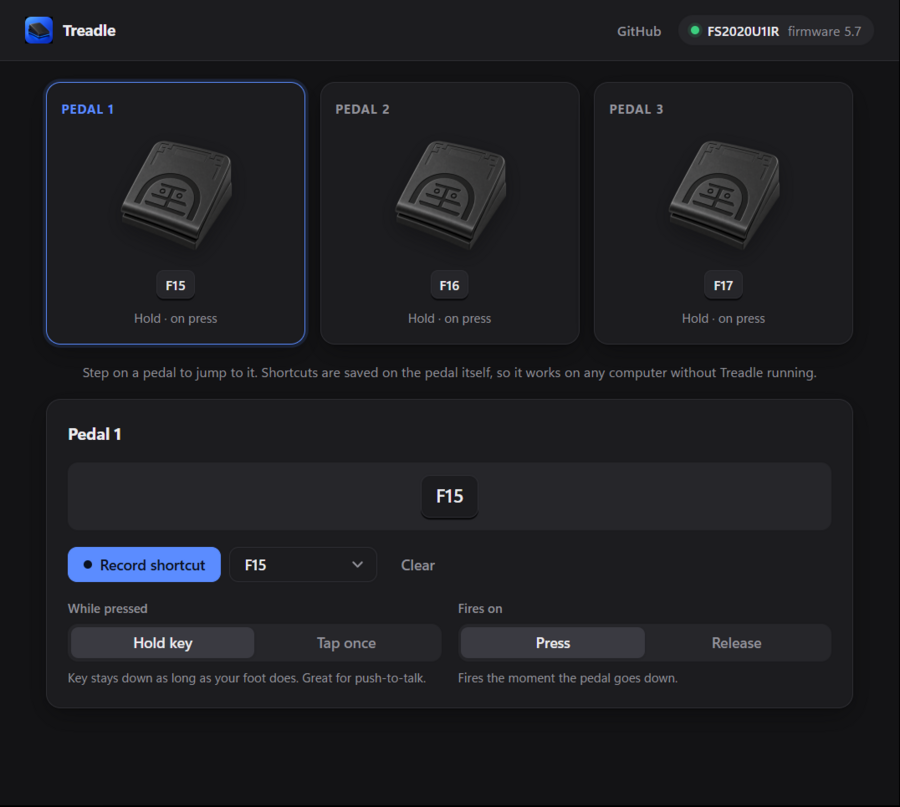

# Treadle: foot pedal software for PCsensor & iKKEGOL USB foot switches

Treadle is a clean, modern, open-source configurator for PCsensor and iKKEGOL
USB foot pedals (FS2020, FS2017, FS2016 and similar). It's a small, fast
replacement for the vendor's FootSwitch app. Set each pedal to a key or
shortcut, choose hold or tap, and save it straight to the pedal.



## Download

Grab the Windows installer from the
[latest release](https://github.com/thekdence/treadle-footswitch/releases/latest),
run it, and open **Treadle** from the Start menu. macOS and Linux builds are
coming; for now you can build them from source (below).

## Features

- **Record a shortcut** by pressing it, or pick any key from a list,
  including F13–F24.
- **Hold or tap.** The key can stay down while your foot does (good for
  push-to-talk), or fire once per press.
- **Press or release.** Choose whether the pedal fires when it goes down or
  when you lift your foot.
- **All your pedals at a glance.** Each pedal gets a tile showing its shortcut.
  Step on a pedal and its tile lights up and opens for editing.
- **Saved on the pedal.** Mappings live in the pedal's own memory, so it works
  on any computer without Treadle running.

Built with [Tauri 2](https://tauri.app) (Rust) and React. The app is a few MB
and starts instantly.

## Supported devices

| Model | USB ID | Status |
| --- | --- | --- |
| iKKEGOL triple pedal (firmware FS2020U1IR_V5.7) | `3553:b001` | Tested: reading and saving |
| Other PCsensor / iKKEGOL pedals | `3553:b001`, `0c45:7403`, `0c45:7404`, `413d:2107`, `1a86:e026` | Should work, untested |

If you try another model, please open an issue with its firmware string (shown
in the top-right of the app) and whether it worked.

**Not editable yet:** mouse, typed-text, media-key and macro actions. Treadle
shows them and leaves them untouched when you save.

## Development

You need [Rust](https://rustup.rs), [Node.js](https://nodejs.org) 20+ and the
[Tauri prerequisites](https://tauri.app/start/prerequisites/) for your
platform.

```bash
npm install
npm run tauri dev
```

No pedal handy? `npm run dev` opens the UI in a browser with a simulated
pedal (`?pedal=none` and `?pedal=other` show the other states).

Run the protocol tests:

```bash
cargo test --manifest-path src-tauri/Cargo.toml
```

With a pedal plugged in, a round-trip test changes the last pedal, checks it,
and restores it:

```bash
cargo test --manifest-path src-tauri/Cargo.toml --test hardware -- --ignored
```

Build an installer:

```bash
npm run tauri build
```

On **Linux**, give your user access to the pedal with a udev rule like the
one in [rgerganov/footswitch](https://github.com/rgerganov/footswitch/blob/master/19-footswitch.rules).

On **macOS**, Treadle only talks to the pedal's configuration interface, never
to your keyboard input, so it shouldn't need Input Monitoring permission.
macOS builds are untested so far; reports are welcome.

## How it works

See [docs/PROTOCOL.md](docs/PROTOCOL.md) for the USB protocol.

- `src-tauri/src/pedal/protocol.rs` encodes and decodes commands. It's pure
  code, unit-tested against captured device replies.
- `src-tauri/src/pedal/device.rs` handles USB I/O via `hidapi`.
- `src/` is the React UI.

## Credits

The protocol builds on [rgerganov/footswitch](https://github.com/rgerganov/footswitch)
by Radoslav Gerganov and contributors (MIT).

Treadle isn't affiliated with PCsensor.

## License

[MIT](LICENSE)
